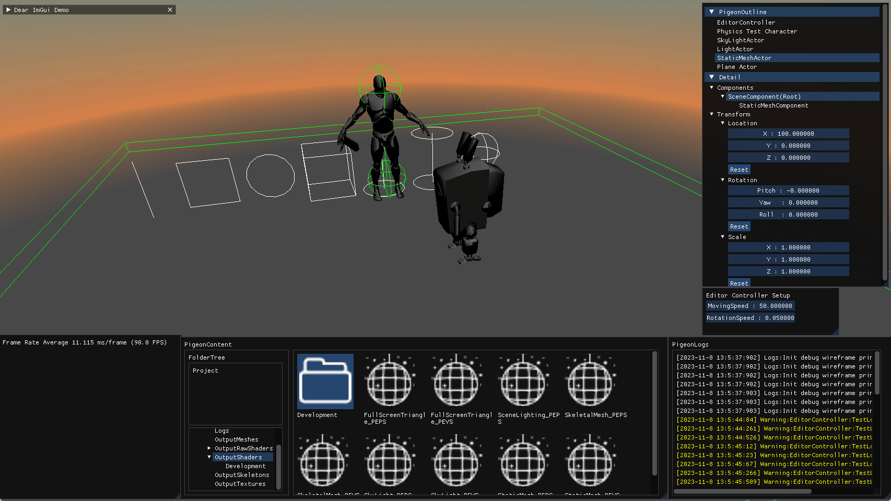

# Pigeon Engine
A game engine for Windows

## Third Party Lib
| Name |  Description | URL |
| ---- | ---- | ---- |
| assimp | Open Asset Import Library is a library to load various 3d file formats into a shared, in-memory format. | [assimp](https://github.com/assimp/assimp) |
| imgui | Dear ImGui is a bloat-free graphical user interface library. | [imgui](https://github.com/ocornut/imgui) |
| rapidjson | A fast JSON parser/generator for C++ with both SAX/DOM style API. | [rapidjson](https://github.com/Tencent/rapidjson/) |
| JoltPhysics | A multi core friendly rigid body physics and collision detection library. | [JoltPhysics](https://github.com/jrouwe/JoltPhysics) |
| recastnavigation | Navigation mesh generation (Recast) and pathfinding (Detour) toolkit. | [recastnavigation](https://github.com/recastnavigation/recastnavigation) |
| DirectXShaderCompiler | HLSL compiler used by the standalone `ShaderCompiler.exe` tool. | [DirectXShaderCompiler](https://github.com/microsoft/DirectXShaderCompiler) |

## Engine Preview

## Type Name Rule
| Example Type Name |  Name Type Rule |
| ---- | ---- |
| _TClass_ | Naming conventions for template classes **START** with a "T" |
| _EnumType_ | Naming conventions for enum type **END** with a "Type" |
| _EClass_ _EStruct_ | Naming conventions for general classes in engines **START** with a "E" |
| _PClass_ _PStruct_ | Naming conventions for game object classes **START** with a "P" |
| _RClass_ _RStruct_ | Naming conventions for render pipeline classes **START** with a "R" |
| _FClass_ _FStruct_ | Naming conventions for physics classes **START** with a "F" |

## Engine Define
| Example Define Name |  Define Rule |
| ---- | ---- |
| ENGINE_DEBUG_MODE | This mode will run with **complete** log and **complete** other profiler options. |
| ENGINE_DEVELOP_MODE | This mode will run with **complete** log and **selectional** other profiler options. |
| ENGINE_SHIPPING_MODE | This mode will run with **few** log and **NO** other profiler options. |
| ENGINE_EDITOR_ONLY | This define makes a distinction between **Editor** and **Runtime** (set for `DebugEditor` and `DevelopEditor`). |

Build configurations: `Debug`, `DebugEditor`, `Develop`, `DevelopEditor`, `Shipping`.
`PIGEON_ENABLE_PROFILER` is forced off in `Shipping`.

## Engine System

### Asset System
Asset System :\
  Texture Asset(Texture2D TextureCube PNG JPEG... -> PAsset)\
  Mesh Asset(FBX OBJ... -> PAsset, static and skinned)\
  Skeleton Asset(FBX... -> PAsset)\
  Animation Asset(FBX... -> PAsset; Clip, StateMachine, Montage, Notify)\
  NavMesh Asset(baked Recast tiles and tile cache layers -> PAsset, committed under `Assets/NavMeshAssets`)\
  Shader Asset(HLSL -> DXC -> bytecode + reflection -> PAsset)\
  Level Asset(`Assets/Levels/*.PLevel`, stable class names + property metadata)

### Actor System
Actor Component System :\
  Camera View\
  Light\
  Sky\
  Primitive

### Physic System
JoltPhysic :\
  Body\
  ConvexComponent(Shape Constrain)

### Navigation System
Navigation :\
  ENavigationProviderInterface(backend contract: build, queries, persistence, obstacles, crowd)\
  ENavigationManager(per-world state, async bake worker, obstacle and crowd replay)\
  PNavMeshActor(one agent profile + the navmesh built for it; level-level build)\
  PNavMeshBoundsComponent(bake volume bounds and supported agent profiles)\
  PNavAgentComponent(path following, or crowd steering for local avoidance)\
  PNavObstacleComponent(dynamic obstacle for a tiled volume)

### Render System
RenderScene :\
  ViewProxy(Culling)\
  LightProxy(Culling)\
  PrimitiveSceneProxy(snapshot + factory; static mesh, skeletal mesh, grass, water)\
  RenderThread(1-frame lockstep: GameThread publishes command slots, RenderThread records and presents)\
Deferred Rendering :
  PBR GBuffer(GBufferA GBufferB GBufferC)\
  RHI backends: D3D11 (default, `ENGINE_GRAPHICS_API = 1`) and D3D12 (`= 2`)

#### Material System
TODO

#### Render Features
HiZCulling
GTAO

## NOTE
Name of skeleton's bone can not large than 512 bytes(char[512]), because we use char[512] for serialization / deserialization
For now we can not import skeleton mesh that effect bone num is over 16
